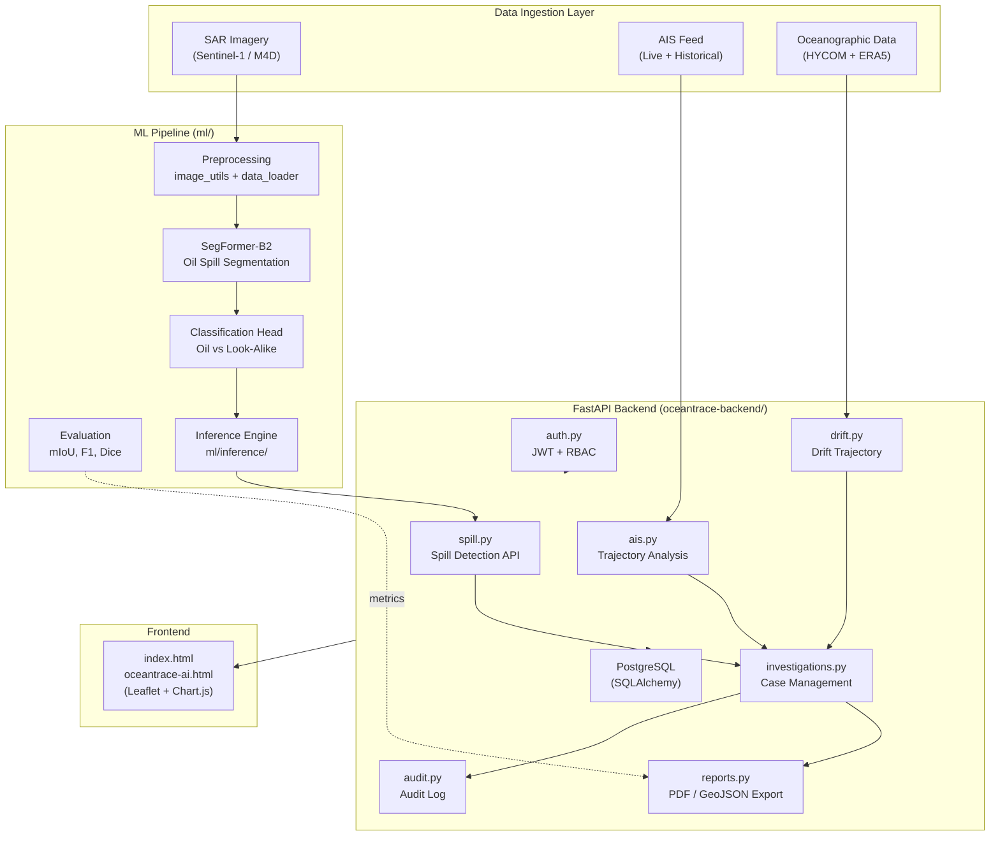
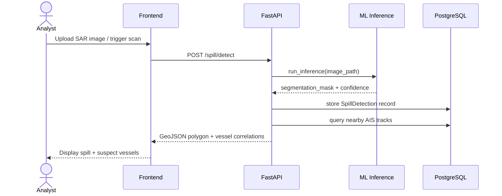
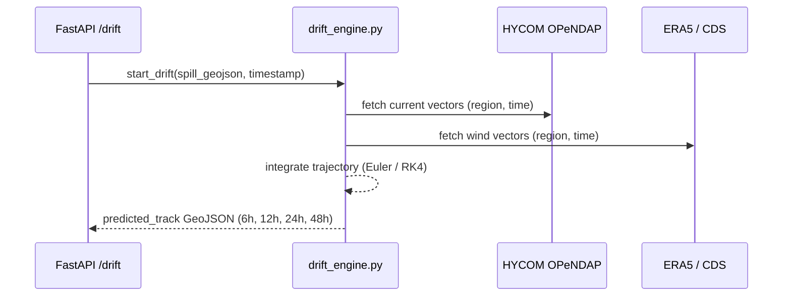

# OceanTrace AI — System Architecture

## Overview

OceanTrace AI is a maritime intelligence platform that fuses satellite SAR imagery, AIS vessel tracking, and oceanographic data to detect oil spills, correlate them with vessels, and model drift trajectories.

---

## High-Level Architecture



---

## Component Breakdown

### 1. Data Ingestion

| Component | Technology | Description |
|---|---|---|
| SAR Imagery | Sentinel-1 / M4D dataset | Primary oil spill detection data |
| AIS Feed | Real-time NMEA / CSV | Vessel position and identity |
| Ocean Currents | HYCOM OPeNDAP / NetCDF | Used for drift trajectory |
| Wind Data | ERA5 via CDS API | Wind forcing for drift model |

### 2. ML Pipeline (`ml/`)

```
ml/
├── datasets/
│   ├── dataset_download.py    # Automated dataset fetching
│   └── dataset_validation.py  # Quality checks & class distribution
├── preprocessing/
│   ├── image_utils.py         # Load, normalize, augment SAR/RGB images
│   └── data_loader.py         # PyTorch Dataset & DataLoader factory
├── segmentation/              # SegFormer-B2 training scripts
├── classification/            # Binary classification head
├── evaluation/                # mIoU, F1, confusion matrix
└── inference/                 # Production inference wrapper
```

### 3. Backend (`oceantrace-backend/backend/`)

| Router | Responsibility |
|---|---|
| `auth.py` | JWT authentication, role-based access control |
| `ais.py` | AIS data ingestion, anomaly flagging |
| `spill.py` | Oil spill detection trigger, result storage |
| `drift.py` | Drift trajectory simulation |
| `investigations.py` | Incident case management |
| `reports.py` | Evidence export (PDF, GeoJSON, CSV) |
| `audit.py` | Tamper-evident audit log |

### 4. Frontend

- Single-page application using **Leaflet.js** for maritime map rendering.
- Real-time vessel overlays and spill polygons via WebSocket/REST.
- Chart.js dashboards for anomaly timelines.

---

## Data Flow — Oil Spill Detection



---

## Data Flow — Drift Modelling



---

## Deployment Architecture

```
                        ┌──────────────────────┐
                        │   Reverse Proxy      │
                        │   (nginx / Caddy)    │
                        └────────┬─────────────┘
                                 │
              ┌──────────────────┼──────────────────┐
              │                  │                  │
     ┌────────▼───────┐ ┌────────▼────────┐ ┌──────▼────────┐
     │  FastAPI        │ │  ML Worker      │ │  Static Files  │
     │  (uvicorn)      │ │  (Celery/async) │ │  index.html    │
     └────────┬────────┘ └────────┬────────┘ └───────────────┘
              │                   │
     ┌────────▼────────┐ ┌────────▼────────┐
     │  PostgreSQL      │ │  GPU Inference  │
     │  + PostGIS       │ │  (CUDA/CPU)     │
     └─────────────────┘ └─────────────────┘
```

---

## Key Design Decisions

| Decision | Rationale |
|---|---|
| SegFormer-B2 for segmentation | Strong mIoU/speed trade-off; MiT encoder captures multi-scale texture well for SAR |
| FastAPI async backend | Low-latency API for real-time AIS ingestion and WebSocket streaming |
| PostGIS for spatial queries | Efficient geospatial indexing for vessel correlation and spill polygon overlap |
| HYCOM OPeNDAP | No bulk download needed; query only the region/time needed |
| Modular `ml/` package | Separates ML concerns from API; allows independent training pipeline |

---

## Directory Layout (Complete)

```
Smart-India-Hackthn-main/
├── index.html                   # Main frontend (Leaflet map)
├── oceantrace-ai.html           # Alternate frontend
├── DATASET_CATALOG.md           # Dataset reference
├── DATA_SOURCES.md              # Download procedures
├── MODEL_CARD.md                # SegFormer-B2 model card
├── requirements_ml.txt          # ML Python dependencies
├── .gitignore_additions.txt     # Gitignore additions
│
├── oceantrace-backend/
│   └── backend/                 # FastAPI application
│
├── ml/                          # Machine learning pipeline
│   ├── datasets/
│   ├── preprocessing/
│   ├── segmentation/
│   ├── classification/
│   ├── evaluation/
│   └── inference/
│
├── notebooks/                   # Exploratory / analysis notebooks
├── data/
│   ├── raw/                     # Downloaded raw datasets
│   ├── processed/               # Pre-processed tensors / tiles
│   └── samples/                 # Small sample files for testing
├── artifacts/
│   ├── checkpoints/             # Model weights (.pth)
│   ├── metrics/                 # Training curves, eval JSON
│   └── predictions/             # Saved inference outputs
├── reports/                     # Generated PDF / HTML reports
├── tests/
│   ├── unit/
│   └── integration/
└── docs/
    └── ARCHITECTURE.md          # This file
```
